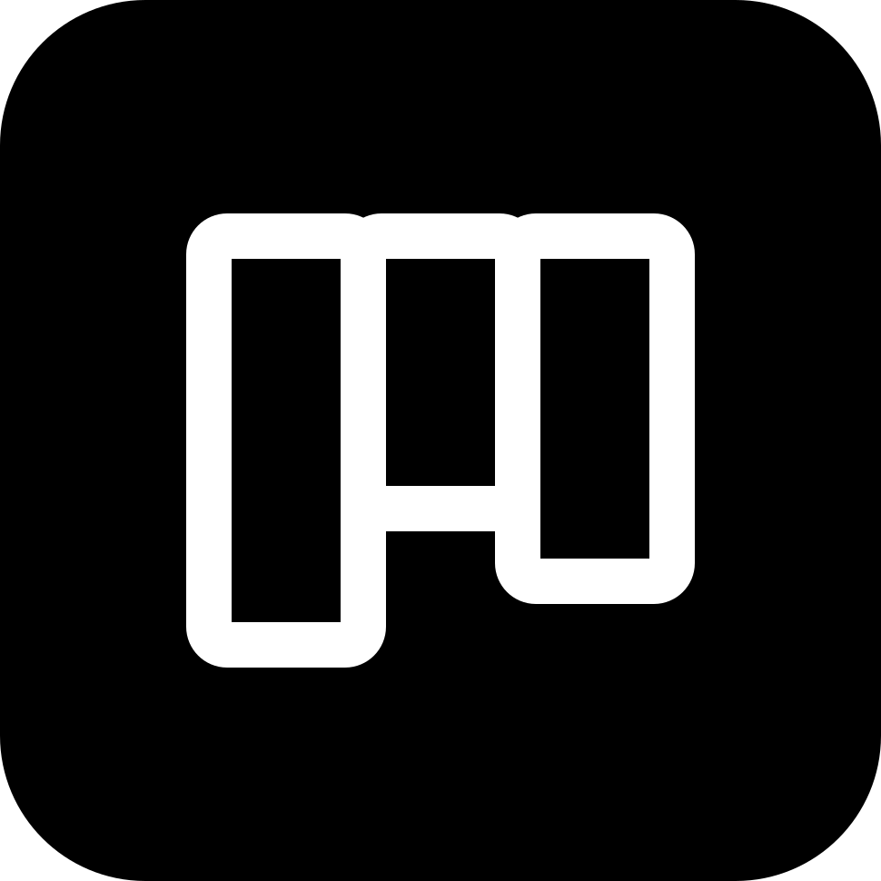

<div align="center">
  
  <h1>gray-kanban</h1>
  <p><strong>A self-contained per-project kanban board: backlog, todo, doing, review, done.</strong></p>
  <p>
    <a href="https://gray.alignment.id">Website</a> ·
    <a href="https://gray.alignment.id/plugins/gray-kanban">Store</a> ·
    <a href="https://github.com/vstaln/gray-kanban">Source</a> ·
    <a href="https://github.com/vstaln/gray">gray</a>
  </p>
  <p>
    <a href="LICENSE"></a>
    <a href="https://www.rust-lang.org"></a>
    <a href="https://gray.alignment.id/plugins/gray-kanban"></a>
  </p>
</div>

<br/>

```bash
gray plugin install gray-kanban
```

Self-contained per-project kanban board
(backlog/todo/doing/review/done).

A sidecar plugin for [gray](https://github.com/vstaln/gray).

## What it does

- `kanban` tool: `{action: "boards"|"create"|"add"|"move"|"done"|"show"|"rm", board?, title?, col?, id?, note?}`
- `/kanban [board]` renders the board as text columns; `/kanban boards` lists boards
- `/kanban move [board]` — interactive card move (needs the `host.ask`
  capability): step 1 picks a card, step 2 picks the target column, and the
  move runs through the same path as the tool's `move` action. Without an
  ask channel it just renders the board.
- Boards are stored under `~/.gray/kanban/<cwd-hash>/<board>.json`, keyed by the
  session's working directory — each project gets its own set of boards.
- Columns: `backlog | todo | doing | review | done`. Card ids: `k1`, `k2`, …
  Default board is `main`; `add` auto-creates it.

## Wire methods

`plugin/manifest`, `tool/call`, `command/run`, `plugin/shutdown`, plus
sidecar→host `host/ask` for `/kanban move` — protocol 1.1. Capability:
`host.ask` (the command degrades to the board render without it).

## Install

```sh
gray plugin install kanban
gray plugin capabilities kanban --all   # grants host.ask → /kanban move picker
```

## Develop

```sh
cargo test
gray account check      # entry point + manifest handshake
gray account publish    # check → build → release → publish to the gray registry
```

## Tags

`gray` `plugin` `kanban` `rust`

---

Part of the [gray](https://github.com/vstaln/gray) plugin ecosystem —
the open-source AI agent harness. <https://gray.alignment.id>
